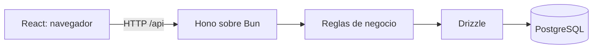

# Decisiones de arquitectura

Fecha: 24 de octubre de 2026.

## Contexto

La tienda de snacks de la UAB tiene dos personas que atienden ventas y un cajero. Los recreos duran aproximadamente diez minutos y los desplazamientos entre bloques consumen parte de ese tiempo. Se presentan aglomeraciones, cobros en efectivo y QR y dificultades para calcular los importes vendidos al finalizar el día mediante registros manuales.

El proyecto es individual. La institución permite elegir tecnologías. El estudiante prefiere React, una SPA y Bun como entorno de ejecución. Esta propuesta reemplaza la recomendación inicial de Django.

## Tecnologías

| Componente | Elección | Justificación |
| --- | --- | --- |
| Lenguaje | TypeScript | Compartir el lenguaje entre cliente y servidor y detectar errores de tipos durante el desarrollo. |
| Interfaz | React + Vite | Construir una SPA con componentes y compilación de recursos para el navegador. |
| Diseño | Tailwind CSS + shadcn/ui | Disponer de estilos y componentes adaptables al flujo de trabajo de la tienda. |
| Navegación | React Router | Asociar pantallas con rutas y permitir navegación interna de la SPA. |
| Ejecución | Bun | Ejecutar el backend y gestionar dependencias y scripts. |
| API | Hono | Organizar rutas HTTP, middleware y respuestas de la API sobre Bun. |
| Persistencia | PostgreSQL | Representar relaciones y aplicar restricciones y transacciones. |
| Consultas y migraciones | Drizzle ORM | Mantener un esquema tipado y migraciones SQL revisables. |
| Validación | Zod | Validar entradas en el servidor y reutilizar contratos cuando resulte útil. |

React es la biblioteca de interfaz; Vite es una herramienta de desarrollo y compilación. Bun y Node.js son entornos de ejecución: el backend de este proyecto utilizará Bun. Los tipos de TypeScript no sustituyen la validación de datos recibidos por HTTP.

Al implementar se elegirán versiones estables compatibles, se fijarán las dependencias y se comprobará el controlador PostgreSQL elegido para Drizzle. No se adoptarán automáticamente versiones preliminares presentes en ejemplos de documentación.

## Organización

Arquitectura cliente-servidor con una SPA y un backend monolítico modular. El backend tendrá separación de presentación HTTP, lógica de negocio y acceso a datos.



Estructura prevista; estas carpetas de aplicación aún no están creadas:

```text
apps/
  web/                 # SPA, componentes y pantallas
  api/                 # API, servicios y acceso a datos
packages/
  shared/              # Contratos compartidos que realmente se necesiten
docs/
```

Los módulos iniciales serán productos, ventas, reportes y acceso de usuarios. Se mantendrá un único repositorio con workspaces de Bun. En desarrollo, Vite redirigirá /api al servidor Hono. Para el despliegue se priorizará servir SPA y API bajo el mismo origen. La instalación de PostgreSQL y el alojamiento se definirán al preparar el entorno.

## Modelo de datos preliminar

| Entidad | Atributos principales |
| --- | --- |
| Categoría | Identificador, nombre, estado. |
| Producto | Identificador, código único, nombre, categoría, precio, estado y fechas de registro/modificación. |
| Usuario | Identificador, cuenta, hash de contraseña, rol y estado. |
| Venta | Identificador, responsable, estado, fecha de creación y fecha de confirmación. |
| Detalle de venta | Venta, producto, cantidad, nombre y precio unitario conservados al vender. |
| Pago | Venta, método, importe, estado, referencia opcional, usuario y fecha de confirmación. |

Relaciones: una categoría tiene varios productos; una venta tiene varios detalles; cada detalle pertenece a un producto; cada venta tiene un responsable. Para la primera entrega se propone un pago por venta, en efectivo o QR. Los pagos combinados quedan fuera del alcance inicial.

El esquema físico, índices y restricciones se especificarán antes de crear las migraciones.

## Reglas de integridad

- Moneda inicial: bolivianos (BOB). Cantidades enteras positivas para productos vendidos por unidad.
- Usar NUMERIC(12,2) para importes en PostgreSQL. En TypeScript, realizar los cálculos en centavos enteros con límites explícitos y conversiones exactas, evitando aritmética monetaria con decimales binarios.
- Los precios y nombres guardados en los detalles conservan la información histórica aunque cambie el catálogo.
- Desactivar productos utilizados en ventas; no eliminar su historial.
- Calcular importes en el servidor a partir de productos válidos, sin confiar en totales enviados por el navegador.
- Confirmar venta y pago dentro de una transacción y proteger la operación frente a dobles envíos.
- Una venta confirmada debe tener un pago confirmado por su importe total.
- El importe cobrado en efectivo para el reporte corresponde al valor de la venta, no al billete recibido antes de dar cambio.
- Registrar fecha y hora con zona temporal y consultar días según America/La_Paz. El reporte inicial se basa en la fecha de confirmación.
- El reporte incluye ventas confirmadas con pagos confirmados; excluye pendientes y anuladas.
- Conservar motivo y responsable de anulaciones. Los reembolsos y las anulaciones posteriores a un cierre requerirán reglas adicionales antes de implementar cierre de caja.
- La verificación QR inicial es manual por el cajero. Mostrar un QR o adjuntar una imagen no confirma por sí mismo un pago bancario.

## Interfaces y acceso

Diseñar para tareas breves: búsqueda visible, precio legible, botones claros, navegación por teclado, etiquetas de formulario, validaciones junto al campo y estados de carga, error y lista vacía. El aspecto final depende de estas decisiones, no solo de elegir React.

Autenticación prevista con sesiones de servidor y cookies HttpOnly; configurar expiración, protección CSRF y Secure bajo HTTPS. Los permisos se comprobarán en la API. Los roles operativos se definirán al validar el flujo de atención; el catálogo y los reportes tendrán acceso autorizado desde la primera entrega.

## Referencias oficiales

- [Bun: runtime](https://bun.sh/docs/runtime)
- [Vite: guía](https://vite.dev/guide/)
- [Hono sobre Bun](https://hono.dev/docs/getting-started/bun)
- [shadcn/ui con Vite](https://ui.shadcn.com/docs/installation/vite)
- [Drizzle y PostgreSQL](https://orm.drizzle.team/docs/get-started-postgresql)
- [Tipos numéricos de PostgreSQL](https://www.postgresql.org/docs/current/datatype-numeric.html)
