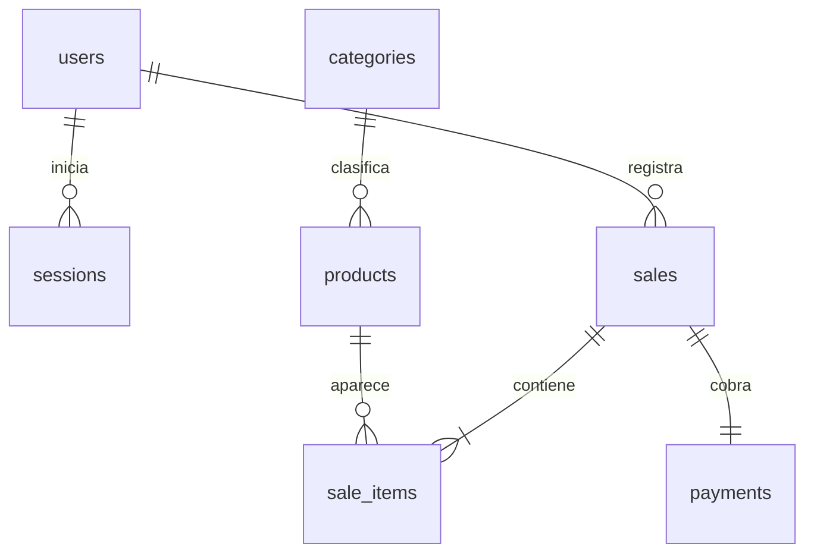

# Modelo de datos implementado

PostgreSQL con migraciones SQL de Drizzle. Identificadores UUID salvo el correlativo visible de la venta.

La existencia de al menos un detalle y exactamente un pago por venta es una regla del servicio ejecutada en una transacción. La clave única de `payments.sale_id` impide más de un pago; una FK sola no obliga a que ese pago exista.

| Tabla | Propósito y restricciones |
| --- | --- |
| users | Nombre, correo único, hash de contraseña, rol y estado activo. |
| sessions | Hash del token, usuario y vencimiento; token original solo en cookie HttpOnly. |
| categories | Nombre único de categoría. |
| products | Código único, nombre, categoría, precio positivo, estado y fechas. |
| sales | Correlativo, identificador/hash de solicitud, responsable, total, fecha y datos de anulación. |
| sale_items | Producto, cantidad positiva y nombre/precio históricos. |
| payments | Un pago por venta: método, importe, estado, efectivo recibido y referencia. |

## Decisiones de integridad

- Las FK preservan relaciones. No se elimina en cascada el historial comercial.
- Dinero en `NUMERIC(12,2)`; cálculos del servidor en centavos enteros.
- El nombre y precio en el detalle son una instantánea histórica deliberada.
- Total, detalles y pago se guardan juntos; el servicio garantiza la igualdad entre venta y pago.
- La anulación conserva motivo, fecha y usuario y cambia el estado del pago.
- `request_id` único evita duplicados concurrentes; `request_hash` impide reutilizarlo con contenido diferente.
- Al confirmar se bloquean en modo compartido los productos y se comprueban actividad y precio esperado.
- Los reportes usan una transacción de lectura repetible para mantener coherencia entre tarjetas, gráficos y filas.
- Hay índices para la fecha de venta y los detalles por venta.
- Las fechas usan `timestamp with time zone` y se agrupan según `America/La_Paz`.
- Los correlativos pueden tener saltos y no constituyen numeración fiscal.

La base inicial admite ventas y pagos `confirmed` o `void`. Un carrito sin cobrar no es una venta persistida. Los pedidos pendientes requieren una ampliación posterior.
